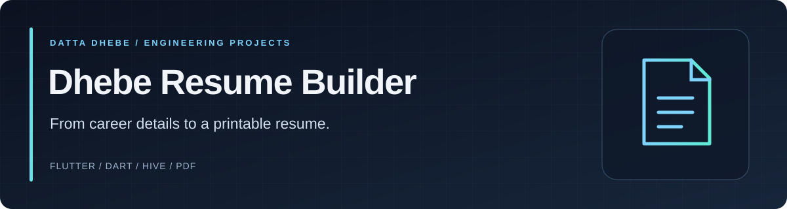

<p align="center">
  
</p>

<p align="center"><a href="#quick-start">Quick start</a> · <a href="#a-guided-code-tour">Code tour</a> · <a href="#development">Development</a></p>


A Flutter application for drafting, editing and exporting resumes. The repository includes structured resume models, local persistence, text import, template selection, and a PDF preview/export workflow.

## Highlights

- Edit personal information, career summary, skills, experience, education and projects.
- Start from imported resume text using section and contact-detail parsing.
- Choose ATS, Executive Edge or Fresher Spotlight PDF layouts.
- Preview generated resumes, save PDFs, and use the platform print/share workflow.
- Store resume data locally with Hive.
- Manage application state with Provider and navigate with GoRouter.

**Status:** application prototype. Text import is heuristic, and any in-app ATS/completion score is a local indicator rather than a verified hiring-system assessment.

## Quick start

Install Flutter with a Dart SDK compatible with the constraint in [pubspec.yaml](pubspec.yaml), plus the Android development tools for an Android build.

```bash
flutter pub get
flutter run
```

Build an Android APK:

```bash
flutter build apk --release
```

Use the Android project under [android](android) for signing and device configuration. No app-store release or downloadable production build is claimed here.

## A guided code tour

| Location | Responsibility |
| --- | --- |
| [lib/models/resume_model.dart](lib/models/resume_model.dart) | Structured resume data |
| [lib/providers/resume_provider.dart](lib/providers/resume_provider.dart) | Resume state and editing workflow |
| [lib/screens](lib/screens) | Dashboard, import, editor, templates and preview screens |
| [lib/templates](lib/templates) | PDF layout implementations |
| [lib/services/pdf_service.dart](lib/services/pdf_service.dart) | PDF generation, saving and printing |
| [lib/services/resume_import_service.dart](lib/services/resume_import_service.dart) | Resume text parsing |
| [lib/services/storage_service.dart](lib/services/storage_service.dart) | Local persistence |

## Development

```bash
flutter analyze
flutter test
```

Review imported fields and the final PDF before sharing a resume.

Built by [Datta Dhebe](https://github.com/DattaDhebe).
